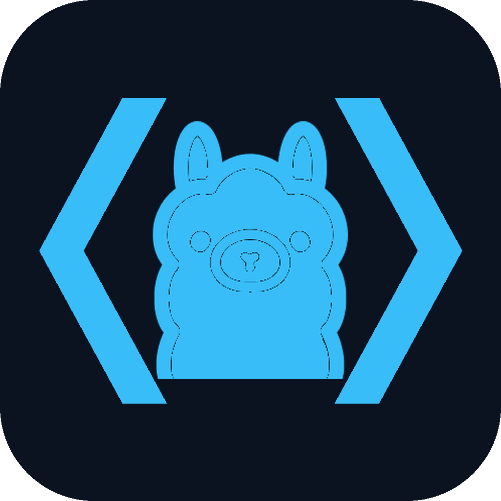

# OllamaCode

Локальный AI-агент на базе Code-OSS и [Ollama](https://ollama.com).  
Свой редактор, tools, thinking — без облачного Copilot.



## Возможности

- Чат-агент с tools (файлы, терминал, поиск, MCP)
- Thinking / chain-of-thought из коробки
- Длинный контекст + VCTX (упаковка истории)
- Свой UI на Code-OSS, не надстройка над Cursor

## Требования

- Windows 10/11 x64
- [Ollama](https://ollama.com/download)
- Модель с tools + thinking (например `agent36` / Qwen3.6 MoE)

## Быстрый старт

1. Скачай **Windows build** из [Releases](../../releases)
2. Распакуй и запусти `OllamaCode.exe`
3. Убедись, что Ollama запущена (`ollama serve`)
4. В чате выбери локальную модель

Из исходников:

```powershell
.\scripts\bootstrap-oss.ps1
.\scripts\launch.ps1
```

Ярлык на рабочий стол:

```powershell
.\scripts\install-shortcut.ps1
```

## Репозиторий

| Путь | Назначение |
|------|------------|
| `extensions/ollama-agent` | Агент, tools, VCTX |
| `ide/` | product.json, иконки |
| `scripts/` | bootstrap / launch / bundle |
| `models/` | Modelfile-профили |

## Лицензия

MIT — см. [LICENSE](LICENSE).
